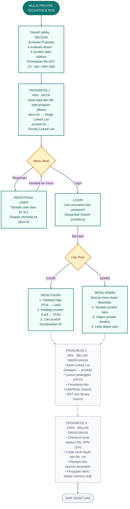

# PRODUCT REQUIREMENT DOCUMENT (PRD) — EDISI EVALUASI FINAL

# TechStock — Sistem Point of Sale (POS) & Inventaris Toko Komputer Berbasis ADT Struktur Data C++

| Atribut Dokumen | Keterangan |
|---|---|
| **Nama Sistem** | TechStock |
| **Mata Kuliah** | Struktur Data (CDK2AAB4) |
| **Dosen Pengampu** | Bapak Rakhmad Maulidi, S.Kom., M.Kom |
| **Kelompok / Kelas** | Kelompok 2 / S1IF-13 |
| **Anggota Kelompok** | 1. Yudwitama Ahlan Putra H.B (109082530016) 2. Sofwan Nuha Al Faruq (109082500032) 3. Rachma Agustina Yassin (109082500046) 4. Zhafif Iqbal Kurniawan (109082500051) |
| **Bahasa & Paradigma** | C++ Standar Perkuliahan dengan Pemisahan Abstract Data Type (ADT `.h`, `.cpp`, `main.cpp`) |
| **Penyimpanan Data** | File Teks Sederhana (`akun.txt` & `produk.txt`) |
| **Platform Target** | Command Line Interface (CLI / Console) |
| **Status Dokumen** | PRD Final Hasil Evaluasi Dosen (Acuan Bertahap Progress 1, Progress 2, dan Tahap Akhir) |

## 1. Pendahuluan & Penyelarasan Evaluasi Dosen

### 1.1 Latar Belakang Masalah
Operasional toko komputer modern menangani ratusan hingga ribuan *Stock Keeping Unit* (SKU) komponen rakitan (seperti Processor, Motherboard, RAM, SSD NVMe, dan VGA) yang memiliki karakteristik khusus:
1. **Keamanan Akses Pengguna (Login & Role):** Sistem kasir wajib membedakan hak akses antara **Admin Toko** (yang berhak mengelola stok barang serta akun) dan **Kasir** (yang melayani transaksi pelanggan).
2. **Perubahan Katalog Dinamis:** Barang baru datang dan barang lama dihapus setiap waktu sehingga membutuhkan struktur penyimpanan dinamis berbasis pointer yang terhubung dengan penyimpanan file `.txt`.
3. **Pengelompokan Kategori & Kompatibilitas Komponen:** Setiap produk berada di bawah suatu kategori komponen (relasi *1-to-N*) serta memiliki keterkaitan paket diskon *bundling* dengan komponen lain (relasi *M-to-N*).
4. **Kebutuhan Pencarian Cepat & Ketertiban Meja Kasir:** Kasir membutuhkan pencarian produk yang akurat, pengelolaan antrean pelanggan (*FIFO*), serta mekanisme pembatalan aksi input keranjang (*Undo/Redo* berprinsip *LIFO*).

### 1.2 Penyelarasan 6 Poin Evaluasi Dosen pada PRD Final
Dokumen PRD Final ini menyempurnakan proposal awal berdasarkan 6 poin evaluasi dosen pengampu serta menyelaraskannya dengan 7 slide materi kuliah **Struktur Data (CDK2AAB4)**:
- **Solusi Terkait Struktur Data (Pendekatan Tiap Masalah) & Minimal 4 Model Struktur Data:** Menghilangkan istilah di luar silabus (*AVL Tree*, *Min-Heap*, *N-ary Tree*, *Weighted Graph*) dan memetakan seluruh fitur TechStock ke **6 model Struktur Data murni sesuai perkuliahan**:
  1. **Singly Linked List (SLL)** untuk daftar akun kredensial login (`ListAkun`) dan daftar kategori (`ListKategori`).
  2. **Doubly Linked List (DLL)** untuk katalog produk utama (`ListProduk`).
  3. **Multi-Linked List (MLL) 1-to-N & M-to-N** untuk relasi kategori produk dan relasi rekomendasi *bundling*.
  4. **Queue (Doubly Linked Queue)** untuk antrean pelanggan di meja kasir (*FIFO*).
  5. **Stack (Linked List Stack)** untuk riwayat aksi keranjang *Undo/Redo* (*LIFO*).
  6. **Binary Search Tree (BST)** untuk indeks pencarian cepat ID produk dan tampilan terurut otomatis (*Inorder Traversal*).
- **Riset Metode Pencarian (Sequential Search vs Binary Search):** Memisahkan penggunaan **Sequential Search** ($O(N)$ pada Linked List untuk pencarian nama/kredensial/ID dasar), **Binary Search** ($O(\log N)$ murni pada **Ordered Array** karena membutuhkan akses indeks tengah `tab[mid]` dalam $O(1)$), dan **BST Search** ($O(\log N)$ rata-rata pada struktur pohon pointer dinamis).
- **Pendalaman Kompleksitas & Hal-Hal Mendasar:** Menyertakan perbandingan kompleksitas `U-Array`, `O-Array`, `U-SLL`, `O-SLL`, `DLL`, dan `BST`, serta mematuhi pemisahan primitif `Remove` vs `Deallocate` dan penanganan kondisi khusus (*Empty List* & *1-Element List*).

## 2. Pemetaan Masalah ke Struktur Data (Pendekatan Tiap Masalah)

| No | Masalah pada Sistem TechStock | Struktur Data yang Digunakan | Alasan Pemilihan & Mekanisme Kerja (Sesuai Materi Kuliah) |
|---|---|---|---|
| 1 | Penyimpanan data kredensial pengguna (`username`, `password`, `role`, `nama`) untuk validasi Login. | **Singly Linked List (SLL)** (`ListAkun`) | Data akun hanya perlu ditelusuri satu arah dari `first` ke akhir saat proses verifikasi login maupun saat disimpan ke `akun.txt`, sehingga hemat memori (1 pointer `next` per node). |
| 2 | Pengelolaan katalog produk toko yang dinamis dan butuh ditampilkan dari terlama ke terbaru maupun dari input terbaru ke terlama. | **Doubly Linked List (DLL)** (`ListProduk`) | Memiliki pointer `first`, `last`, `next`, dan `prev` (**Slide 03**). Memungkinkan *traversal* dua arah (maju & mundur) serta membuat operasi `insertLastProduk` dan `deleteLastProduk` berjalan dalam waktu konstan **$O(1)$**. |
| 3 | Pengelompokan produk ke kategori komponen dan rekomendasi pasangan *bundling* rakitan PC. | **Multi-Linked List (MLL)** (Relasi *1-to-N* & *M-to-N*) | Sesuai **Slide 06**, relasi *1-to-N* menghubungkan produk ke kategori induk lewat pointer, sedangkan relasi *M-to-N* menggunakan sub-list di dalam produk untuk mencatat pasangan komponen yang kompatibel. |
| 4 | Antrean pelanggan di meja kasir agar dilayani sesuai urutan kedatangan (*First-In First-Out*). | **Queue (Linked List Queue)** (`QueuePelanggan`) | Sesuai **Slide 05**, menggunakan DLL dengan penambahan di `tail` (`enqueue`) dan pemanggilan di `head` (`dequeue`) dengan waktu **$O(1)$**. |
| 5 | Pembatalan kesalahan input item di keranjang kasir (*Undo* & *Redo*). | **Stack (Linked List Stack ×2)** (`undoStack` & `redoStack`) | Sesuai **Slide 04**, operasi penambahan (`push`) dan pengambilan aksi terakhir (`pop`) dilakukan pada satu ujung `top` (*Last-In First-Out*) dengan waktu **$O(1)$**. |
| 6 | Pencarian produk dengan cepat saat jumlah SKU membesar serta pengurutan otomatis berdasarkan ID. | **Binary Search Tree (BST)** & **Ordered Array** | Sesuai **Slide 07** & **Slide 02**, BST mempercepat pencarian ID berbasis pointer ($O(\log N)$ rata-rata), sedangkan *Binary Search* diterapkan pada *Ordered Array* ($O(\log N)$). |

## 3. Spesifikasi Metode Pencarian & Analisis Kompleksitas

### 3.1 Hasil Riset: Kapan Memakai Sequential Search vs Binary Search?
Sesuai evaluasi dosen dan teori pada **Slide 02 (Hal. 96–108)**:
1. **Sequential (Linear) Search ($O(N)$):**
   - Digunakan pada **Linked List (`SLL` / `DLL`)** untuk mencari kecocokan `username` & `password` saat login, mencari produk berdasarkan nama, atau mencari produk pada katalog berukuran kecil-menengah.
   - **Mengapa Linked List tidak memakai Binary Search?** Karena Linked List tidak memiliki pengindeksan alamat memori yang bersebelahan (*contiguous memory*), sehingga untuk menuju elemen tengah harus menelusuri pointer satu per satu dari `first` sejauh $O(N)$.
2. **Binary Search ($O(\log N)$):**
   - **Hanya sah dan efisien diterapkan pada Ordered Array (`O-Array`)**. Dengan array yang sudah terurut (dibangun lewat algoritma *Insert into a Sorted Array*, **Slide 02 hal. 2–5**), elemen tengah `tab[tengah]` dapat diakses langsung dalam $O(1)$ dan ruang pencarian dibagi dua secara berulang hingga mencapai kompleksitas **$O(\log N)$**.
3. **BST Search ($O(\log N)$ rata-rata):**
   - Merupakan solusi pencarian biner pada struktur dinamis berbasis pointer (**Slide 07 hal. 45–47**). Jika `id < root->keyId` pencarian bergerak ke `left`, dan jika `id > root->keyId` bergerak ke `right`.

### 3.2 Tabel Perbandingan Kompleksitas (Sesuai Slide 02 Hal. 107–108 & Slide 07)

| Operasi Primitif | Unordered Array (`U-Array`) | Ordered Array (`O-Array`) | Unordered SLL (`U-SLL`) | Ordered SLL (`O-SLL`) | Doubly Linked List (`DLL` dgn `first` & `last`) | Binary Search Tree (`BST`) |
|---|---|---|---|---|---|---|
| **Search** | $O(N)$ | **$O(\log N)$** *(Binary Search)* | $O(N)$ | $O(N)$ | $O(N)$ | Rata-rata **$O(\log N)$**, Terburuk $O(N)$ (*Skewed*) |
| **FindMax / FindMin** | $O(N)$ | **$O(1)$** | $O(N)$ | $O(1)$ / $O(N)$ | $O(N)$ | Rata-rata **$O(\log N)$** |
| **Insert First** | $O(N)$ *(Shift)* | $O(N)$ *(Shift)* | **$O(1)$** | $O(N)$ | **$O(1)$** | — |
| **Insert Last** | **$O(1)$** | $O(N)$ | $O(N)$ *(Tanpa `last`)* | $O(N)$ | **$O(1)$** *(Dengan pointer `last`)* | — |
| **Delete First** | $O(N)$ *(Shift)* | $O(N)$ *(Shift)* | **$O(1)$** | **$O(1)$** | **$O(1)$** | — |
| **Delete Last** | **$O(1)$** | **$O(1)$** | $O(N)$ *(Cari `Prec`)* | $O(N)$ | **$O(1)$** *(Lewat `last->prev`)* | — |
| **Insert / Delete After (Pointer `Prec` diketahui)** | $O(N)$ | $O(N)$ | **$O(1)$** | — | **$O(1)$** | — |
| **Insert / Delete jika hanya nilai (`value`) yang diberikan** | $O(N)$ | $O(N)$ | **$O(N)$** *(Harus `search` dulu)* | **$O(N)$** | **$O(N)$** *(Harus `search` dulu)* | Rata-rata **$O(\log N)$** |

## 4. Hal-Hal Mendasar yang Wajib Dipatuhi (Fundamental Guardrails)

1. **Arsitektur ADT Terpisah (`techstock.h`, `techstock.cpp`, `main.cpp`):** Memisahkan deklarasi tipe data dan prototipe fungsi di file `.h` dari detail implementasi di `.cpp` (**Slide 01 hal. 23–28**).
2. **Pemisahan `Remove` vs `Deallocate`:** Prosedur penghapusan list (`deleteLastProduk`, `deleteFirstProduk`) hanya melepas ikatan pointer elemen `P` dari list, sedangkan pembebasan memori dilakukan secara terpisah melalui `dealokasiProduk(P)` (**Slide 02 hal. 93**).
3. **Penanganan Kondisi Khusus (*Special Conditions*):** Wajib memeriksa kondisi **List Kosong (`isEmpty`)** dan **Kondisi 1 Elemen (`first == last`)** pada operasi penghapusan agar tidak terjadi *error* akibat mengakses pointer `NULL` (**Slide 02 hal. 92 & Slide 03 hal. 24–25**).
4. **Persistensi Data Sederhana (`.txt`):** Menggunakan `ofstream` dan `ifstream` untuk menyimpan dan memuat ulang data dari `akun.txt` serta `produk.txt` setiap kali ada perubahan data.

## 5. Peta Jalan Pengembangan Bertahap & Flowchart Checkpoint (Progress 1 s.d. Progress 3)

### 5.1 Tabel Tahapan Pengembangan

| Tahap | Fokus Implementasi | Struktur Data & Fitur yang Dibangun | Status |
|---|---|---|---|
| **Tahap 1: Proposal & Evaluasi** | Perancangan konsep dan penyempurnaan arsitektur berdasarkan 6 poin evaluasi dosen. | Penyusunan PRD Final dan pemetaan 6 struktur data sesuai silabus. | **Selesai (Warna Hijau)** |
| **Tahap 2: Progress Pertama (Fondasi Aplikasi & Login)** | Langkah awal aplikasi: Autentikasi Kredensial Login, Penyimpanan File `.txt`, dan Menu Utama Katalog Dasar. | 1. **SLL (`ListAkun`)** untuk Login (`ADMIN` / `KASIR`), Registrasi Akun, dan penyimpanan ke **`akun.txt`**. 2. **DLL (`ListProduk`)** untuk Katalog Produk Dasar (Tampil Maju, Tampil Mundur, Tambah Produk, Hapus Produk Terakhir + Dealokasi) dan penyimpanan ke **`produk.txt`**. 3. **Sequential Search** untuk autentikasi login dan pencarian produk berdasarkan ID di Menu Utama. | **Sedang Dikerjakan / Aktif (Warna Hijau)** |
| **Tahap 3: Progress Kedua (Pengembangan Inti)** | Penambahan struktur data relasional, antrean, transaksi keranjang, dan pencarian cepat. | 4. **Multi-Linked List (MLL 1-to-N & M-to-N)** untuk pemisahan node Kategori dan rekomendasi *bundling* produk. 5. **Queue (`QueuePelanggan`)** untuk antrean pelanggan FIFO. 6. **Stack (`undoStack` & `redoStack`)** untuk keranjang belanja dan fitur *Undo/Redo* LIFO. 7. **Binary Search Tree (BST)** & **Binary Search pada Ordered Array** untuk perbandingan pencarian cepat ID produk. | **Belum Dikerjakan (Warna Abu-abu)** |
| **Tahap 4: Progress Ketiga / Akhir (Finalisasi & Pengujian)** | Penyelesaian akhir (100%), *checkout* struk, laporan analitik, dan pengujian menyeluruh. | - Alur *Checkout* pembayaran tunai, pengurangan stok otomatis, dan ekspor struk `.txt`. - Laporan penjualan harian & pengujian *edge cases* (antrean kosong, *stack underflow*, katalog kosong). | **Belum Dikerjakan (Warna Abu-abu)** |

### 5.2 Flowchart Checkpoint Proyek (Hijau = Sedang Dikerjakan, Abu-abu = Belum Dikerjakan)

