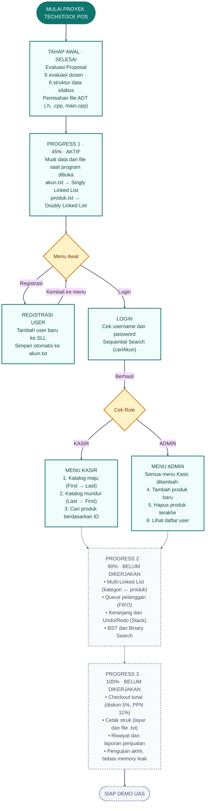

# Dokumentasi & Bedah Kode Tahap Awal (Progress 1) — TechStock POS

**Mata Kuliah:** Struktur Data (`CDK2AAB4`)  
**Dosen Pengampu:** Bapak Rakhmad Maulidi, S.Kom., M.Kom  
**Kelompok 2 (S1IF-13):**
1. Yudwitama Ahlan Putra H.B (`109082530016`)
2. Sofwan Nuha Al Faruq (`109082500032`)
3. Rachma Agustina Yassin (`109082500046`)
4. Zhafif Iqbal Kurniawan (`109082500051`)

## 1. Flowchart Checkpoint Proyek TechStock POS (Tahap Awal s.d. Progress 3)

Diagram *flowchart* di bawah ini memetakan seluruh *checkpoint* pengerjaan **TechStock POS** dari atas ke bawah, dengan pembedaan warna status pengerjaan:
* **Hijau Tosca (Aktif):** Tahap yang **sudah/sedang dikerjakan pada Progress 1**, yaitu Evaluasi Proposal, Registrasi & Login User (`Singly Linked List` + `akun.txt`), pengecekan *role* (`ADMIN` vs `KASIR`), hingga Menu Utama Katalog Produk (`Doubly Linked List` + `Sequential Search` + `produk.txt`).
* **Abu-abu dengan Garis Putus-putus (Direncanakan):** Tahap yang **belum dikerjakan** (Progress 2 & Progress 3), sehingga batas ruang lingkup kode saat ini terlihat jelas.
* **Belah Ketupat Kuning:** Titik percabangan keputusan (menu awal & pengecekan *role*).



## 2. Ruang Lingkup Kode Progress 1 & Pembagian Presentasi Kelompok

Sesuai *flowchart* di atas, kode **Progress 1** difokuskan pada kotak **hijau (Aktif)**, yaitu pintu masuk aplikasi (User & Role Login) serta Menu Utama Katalog Dasar yang tersimpan ke file `.txt`:
* **Anggota 1 (Ahlan):** Menjelaskan konsep **Abstract Data Type (ADT)** & **Pointer** di `techstock.h` (**Slide 01**) serta alur percabangan *role* `ADMIN` vs `KASIR` di `main.cpp`.
* **Anggota 2 (Sofwan):** Menjelaskan primitif **Singly Linked List (SLL)** untuk manajemen *user* (`createListAkun`, `alokasiAkun`, `insertLastAkun`, `cariAkun` dengan *Sequential Search*, dan `printAkun` — **Slide 02**).
* **Anggota 3 (Rachma):** Menjelaskan primitif **Doubly Linked List (DLL)** untuk katalog produk (`createListProduk`, `insertLastProduk`, `deleteLastProduk` dengan kondisi khusus 1 elemen, `dealokasiProduk`, serta traversal maju & mundur — **Slide 03**).
* **Anggota 4 (Zhafif):** Menjelaskan pencarian produk berdasarkan ID (`cariProduk` dengan *Sequential Search*) serta penyimpanan & pembacaan file `.txt` (`simpanAkun`, `muatAkun`, `simpanProduk`, `muatProduk`).

## 3. Source Code Lengkap Progress 1

### A. File Header ADT: `techstock.h`

```cpp
#ifndef TECHSTOCK_H
#define TECHSTOCK_H

#include <iostream>
#include <string>
#include <fstream>

using namespace std;

typedef struct elmAkun *adrAkun;
typedef struct elmProduk *adrProduk;

struct infotypeAkun {
    string username;
    string password;
    string role;
    string nama;
};

struct elmAkun {
    infotypeAkun info;
    adrAkun next;
};

struct ListAkun {
    adrAkun first;
};

struct infotypeProduk {
    string idProduk;
    string namaProduk;
    string kategori;
    long harga;
    int stok;
};

struct elmProduk {
    infotypeProduk info;
    adrProduk next;
    adrProduk prev;
};

struct ListProduk {
    adrProduk first;
    adrProduk last;
};

void createListAkun(ListAkun &LA);
adrAkun alokasiAkun(string user, string pass, string role, string nama);
void insertLastAkun(ListAkun &LA, adrAkun P);
adrAkun cariAkun(ListAkun LA, string user, string pass);
void printAkun(ListAkun LA);
void simpanAkun(ListAkun LA, string namaFile);
void muatAkun(ListAkun &LA, string namaFile);

void createListProduk(ListProduk &LP);
adrProduk alokasiProduk(infotypeProduk data);
void dealokasiProduk(adrProduk &P);
bool isEmptyProduk(ListProduk LP);
void insertLastProduk(ListProduk &LP, adrProduk P);
void deleteLastProduk(ListProduk &LP, adrProduk &P);
adrProduk cariProduk(ListProduk LP, string id);
void printProdukMaju(ListProduk LP);
void printProdukMundur(ListProduk LP);
void simpanProduk(ListProduk LP, string namaFile);
void muatProduk(ListProduk &LP, string namaFile);

#endif
```

### B. File Implementasi Primitif ADT: `techstock.cpp`

```cpp
#include "techstock.h"

void createListAkun(ListAkun &LA) {
    LA.first = NULL;
}

adrAkun alokasiAkun(string user, string pass, string role, string nama) {
    adrAkun P = new elmAkun;
    P->info.username = user;
    P->info.password = pass;
    P->info.role = role;
    P->info.nama = nama;
    P->next = NULL;
    return P;
}

void insertLastAkun(ListAkun &LA, adrAkun P) {
    if (LA.first == NULL) {
        LA.first = P;
    } else {
        adrAkun Q = LA.first;
        while (Q->next != NULL) {
            Q = Q->next;
        }
        Q->next = P;
    }
}

adrAkun cariAkun(ListAkun LA, string user, string pass) {
    adrAkun P = LA.first;
    while (P != NULL) {
        if (P->info.username == user && P->info.password == pass) {
            return P;
        }
        P = P->next;
    }
    return NULL;
}

void printAkun(ListAkun LA) {
    cout << "================================================" << endl;
    cout << "USERNAME   | ROLE   | NAMA PENGGUNA" << endl;
    cout << "================================================" << endl;
    adrAkun P = LA.first;
    while (P != NULL) {
        cout << P->info.username << " | "
             << P->info.role << " | "
             << P->info.nama << endl;
        P = P->next;
    }
    cout << "================================================" << endl;
}

void simpanAkun(ListAkun LA, string namaFile) {
    ofstream fileOut(namaFile.c_str());
    if (fileOut.is_open()) {
        adrAkun P = LA.first;
        while (P != NULL) {
            fileOut << P->info.username << " "
                    << P->info.password << " "
                    << P->info.role << " "
                    << P->info.nama << endl;
            P = P->next;
        }
        fileOut.close();
    }
}

void muatAkun(ListAkun &LA, string namaFile) {
    ifstream fileIn(namaFile.c_str());
    if (!fileIn.is_open()) {
        insertLastAkun(LA, alokasiAkun("admin", "admin123", "ADMIN", "Ahlan_Admin"));
        insertLastAkun(LA, alokasiAkun("kasir1", "kasir123", "KASIR", "Sofwan_Kasir"));
        simpanAkun(LA, namaFile);
        return;
    }

    string user, pass, role, nama;
    while (fileIn >> user >> pass >> role >> nama) {
        insertLastAkun(LA, alokasiAkun(user, pass, role, nama));
    }
    fileIn.close();
}

void createListProduk(ListProduk &LP) {
    LP.first = NULL;
    LP.last = NULL;
}

adrProduk alokasiProduk(infotypeProduk data) {
    adrProduk P = new elmProduk;
    P->info = data;
    P->next = NULL;
    P->prev = NULL;
    return P;
}

void dealokasiProduk(adrProduk &P) {
    delete P;
    P = NULL;
}

bool isEmptyProduk(ListProduk LP) {
    return LP.first == NULL && LP.last == NULL;
}

void insertLastProduk(ListProduk &LP, adrProduk P) {
    if (isEmptyProduk(LP)) {
        LP.first = P;
        LP.last = P;
    } else {
        P->prev = LP.last;
        LP.last->next = P;
        LP.last = P;
    }
}

void deleteLastProduk(ListProduk &LP, adrProduk &P) {
    if (isEmptyProduk(LP)) {
        P = NULL;
    } else if (LP.first == LP.last) {
        P = LP.last;
        LP.first = NULL;
        LP.last = NULL;
    } else {
        P = LP.last;
        LP.last = LP.last->prev;
        P->prev = NULL;
        LP.last->next = NULL;
    }
}

adrProduk cariProduk(ListProduk LP, string id) {
    adrProduk P = LP.first;
    while (P != NULL && P->info.idProduk != id) {
        P = P->next;
    }
    return P;
}

void printProdukMaju(ListProduk LP) {
    if (isEmptyProduk(LP)) {
        cout << "Katalog produk masih kosong." << endl;
    } else {
        cout << "================================================================" << endl;
        cout << "ID      | NAMA PRODUK          | KATEGORI    | HARGA    | STOK" << endl;
        cout << "================================================================" << endl;
        adrProduk P = LP.first;
        while (P != NULL) {
            cout << P->info.idProduk << " | "
                 << P->info.namaProduk << " | "
                 << P->info.kategori << " | Rp"
                 << P->info.harga << " | "
                 << P->info.stok << endl;
            P = P->next;
        }
        cout << "================================================================" << endl;
    }
}

void printProdukMundur(ListProduk LP) {
    if (isEmptyProduk(LP)) {
        cout << "Katalog produk masih kosong." << endl;
    } else {
        cout << "================================================================" << endl;
        cout << "KATALOG PRODUK DARI INPUT TERBARU (MUNDUR: LAST KE FIRST)" << endl;
        cout << "================================================================" << endl;
        adrProduk P = LP.last;
        while (P != NULL) {
            cout << P->info.idProduk << " | "
                 << P->info.namaProduk << " | "
                 << P->info.kategori << " | Rp"
                 << P->info.harga << " | Stok: "
                 << P->info.stok << endl;
            P = P->prev;
        }
        cout << "================================================================" << endl;
    }
}

void simpanProduk(ListProduk LP, string namaFile) {
    ofstream fileOut(namaFile.c_str());
    if (fileOut.is_open()) {
        adrProduk P = LP.first;
        while (P != NULL) {
            fileOut << P->info.idProduk << " "
                    << P->info.namaProduk << " "
                    << P->info.kategori << " "
                    << P->info.harga << " "
                    << P->info.stok << endl;
            P = P->next;
        }
        fileOut.close();
    }
}

void muatProduk(ListProduk &LP, string namaFile) {
    ifstream fileIn(namaFile.c_str());
    if (!fileIn.is_open()) {
        infotypeProduk p1 = {"PRD-001", "Intel_Core_i5", "Processor", 3250000, 10};
        infotypeProduk p2 = {"PRD-002", "ASUS_B760M", "Motherboard", 2450000, 6};
        infotypeProduk p3 = {"PRD-003", "RAM_Kingston_16GB", "Memory", 950000, 20};
        infotypeProduk p4 = {"PRD-004", "SSD_Samsung_1TB", "Storage", 1450000, 5};

        insertLastProduk(LP, alokasiProduk(p1));
        insertLastProduk(LP, alokasiProduk(p2));
        insertLastProduk(LP, alokasiProduk(p3));
        insertLastProduk(LP, alokasiProduk(p4));
        simpanProduk(LP, namaFile);
        return;
    }

    infotypeProduk d;
    while (fileIn >> d.idProduk >> d.namaProduk >> d.kategori >> d.harga >> d.stok) {
        insertLastProduk(LP, alokasiProduk(d));
    }
    fileIn.close();
}
```

### C. File Program Utama: `main.cpp`

```cpp
#include "techstock.h"

int main() {
    ListAkun daftarAkun;
    ListProduk katalogProduk;

    createListAkun(daftarAkun);
    createListProduk(katalogProduk);

    muatAkun(daftarAkun, "akun.txt");
    muatProduk(katalogProduk, "produk.txt");

    int pilihAwal = -1;
    while (pilihAwal != 0) {
        cout << endl;
        cout << "==========================================" << endl;
        cout << "          APLIKASI TECHSTOCK POS          " << endl;
        cout << "==========================================" << endl;
        cout << "1. Login Pengguna" << endl;
        cout << "2. Registrasi User Baru" << endl;
        cout << "0. Keluar Aplikasi" << endl;
        cout << "------------------------------------------" << endl;
        cout << "Pilih menu: ";
        cin >> pilihAwal;

        if (pilihAwal == 1) {
            string user, pass;
            cout << "Username : ";
            cin >> user;
            cout << "Password : ";
            cin >> pass;

            adrAkun akunAktif = cariAkun(daftarAkun, user, pass);
            if (akunAktif == NULL) {
                cout << "Login gagal! Username atau password salah." << endl;
            } else {
                cout << "Login berhasil! Selamat datang, " << akunAktif->info.nama
                     << " (" << akunAktif->info.role << ")" << endl;

                int pilihMenu = -1;
                while (pilihMenu != 0) {
                    cout << endl;
                    cout << "==========================================" << endl;
                    cout << "         MENU UTAMA TECHSTOCK POS         " << endl;
                    cout << "==========================================" << endl;
                    cout << "User Aktif : " << akunAktif->info.nama
                         << " [" << akunAktif->info.role << "]" << endl;
                    cout << "------------------------------------------" << endl;
                    cout << "1. Lihat Katalog Produk (Maju)" << endl;
                    cout << "2. Lihat Katalog Produk (Mundur)" << endl;
                    cout << "3. Cari Produk Berdasarkan ID" << endl;

                    if (akunAktif->info.role == "ADMIN") {
                        cout << "4. [Admin] Tambah Produk Baru" << endl;
                        cout << "5. [Admin] Hapus Produk Terakhir" << endl;
                        cout << "6. [Admin] Lihat Daftar User" << endl;
                    }

                    cout << "0. Logout" << endl;
                    cout << "------------------------------------------" << endl;
                    cout << "Pilih menu: ";
                    cin >> pilihMenu;

                    if (pilihMenu == 1) {
                        printProdukMaju(katalogProduk);
                    } else if (pilihMenu == 2) {
                        printProdukMundur(katalogProduk);
                    } else if (pilihMenu == 3) {
                        string idCari;
                        cout << "Masukkan ID Produk (contoh PRD-001): ";
                        cin >> idCari;
                        adrProduk P = cariProduk(katalogProduk, idCari);
                        if (P != NULL) {
                            cout << "Ditemukan: " << P->info.idProduk << " | "
                                 << P->info.namaProduk << " | "
                                 << P->info.kategori << " | Rp"
                                 << P->info.harga << " | Stok: "
                                 << P->info.stok << endl;
                        } else {
                            cout << "Produk tidak ditemukan." << endl;
                        }
                    } else if (pilihMenu == 4 && akunAktif->info.role == "ADMIN") {
                        infotypeProduk dataBaru;
                        cout << "ID Produk (contoh PRD-005)       : ";
                        cin >> dataBaru.idProduk;
                        cout << "Nama Produk (tanpa spasi/pakai _): ";
                        cin >> dataBaru.namaProduk;
                        cout << "Kategori                         : ";
                        cin >> dataBaru.kategori;
                        cout << "Harga                            : ";
                        cin >> dataBaru.harga;
                        cout << "Stok                             : ";
                        cin >> dataBaru.stok;

                        insertLastProduk(katalogProduk, alokasiProduk(dataBaru));
                        simpanProduk(katalogProduk, "produk.txt");
                        cout << "Produk berhasil ditambahkan ke produk.txt!" << endl;
                    } else if (pilihMenu == 5 && akunAktif->info.role == "ADMIN") {
                        adrProduk P = NULL;
                        deleteLastProduk(katalogProduk, P);
                        if (P != NULL) {
                            cout << "Produk " << P->info.namaProduk << " berhasil dihapus." << endl;
                            dealokasiProduk(P);
                            simpanProduk(katalogProduk, "produk.txt");
                        } else {
                            cout << "Katalog produk sudah kosong." << endl;
                        }
                    } else if (pilihMenu == 6 && akunAktif->info.role == "ADMIN") {
                        printAkun(daftarAkun);
                    } else if (pilihMenu == 0) {
                        cout << "Logout berhasil." << endl;
                    } else {
                        cout << "Menu tidak tersedia." << endl;
                    }
                }
            }
        } else if (pilihAwal == 2) {
            string user, pass, role, nama;
            cout << "Username Baru                    : ";
            cin >> user;
            cout << "Password                         : ";
            cin >> pass;
            cout << "Role (ADMIN/KASIR)               : ";
            cin >> role;
            cout << "Nama Pengguna (pakai _ jika >1)  : ";
            cin >> nama;

            insertLastAkun(daftarAkun, alokasiAkun(user, pass, role, nama));
            simpanAkun(daftarAkun, "akun.txt");
            cout << "User baru berhasil disimpan ke akun.txt!" << endl;
        } else if (pilihAwal != 0) {
            cout << "Pilihan tidak valid." << endl;
        }
    }

    cout << "Terima kasih telah menggunakan TechStock POS." << endl;
    return 0;
}
```

## 4. Bedah Kode Detail per Bagian (Konsep Kuliah & Analogi Awam)

### Bagian 1: Deklarasi Pointer & Struct ADT (`techstock.h`)
* **Fungsi Kode:** Mendefinisikan tipe pointer `adrAkun` dan `adrProduk` menggunakan `typedef`, isi data (`infotypeAkun` dan `infotypeProduk`), bentuk simpul (`elmAkun` dan `elmProduk`), serta pemegang list (`ListAkun` dan `ListProduk`).
* **Konsep Kuliah (**Slide 01 Hal. 15–28**):** Menggunakan pola *Abstract Data Type (ADT)* di mana file `.h` hanya berisi deklarasi tipe dan *prototype* fungsi (*interface*), sedangkan isi logikanya disembunyikan di `.cpp`.
* **Analogi Awam:** Ibarat daftar menu di meja restoran: pengunjung tahu makanan apa saja yang tersedia (`techstock.h`), tetapi cara memasaknya berada di dapur (`techstock.cpp`).

### Bagian 2: Singly Linked List (SLL) untuk Manajemen User (`ListAkun`)
* **Fungsi Kode:** Mengelola akun pengguna melalui `createListAkun`, `alokasiAkun`, `insertLastAkun`, `cariAkun`, dan `printAkun`.
* **Konsep Kuliah (**Slide 02 Hal. 32–61 & Hal. 98**):**
  * `elmAkun` hanya memiliki satu pointer `next` karena daftar akun cukup ditelusuri satu arah dari `first` sampai `NULL`.
  * `cariAkun` menggunakan metode **Sequential Search** ($O(N)$) yang memeriksa satu per satu simpul dari `LA.first` hingga menemukan pasangan `username` dan `password` yang cocok.
* **Analogi Awam:** Ibarat antrean gerbong kereta satu arah. Saat seseorang mau login, petugas mengecek penumpang dari gerbong paling depan (`first`) ke gerbong berikutnya (`next`) sampai menemukan tiket dengan nama dan sandi yang sama.

### Bagian 3: Doubly Linked List (DLL) untuk Katalog Produk (`ListProduk`)
* **Fungsi Kode:** Mengelola katalog barang di Menu Utama melalui `createListProduk`, `alokasiProduk`, `dealokasiProduk`, `insertLastProduk`, `deleteLastProduk`, `cariProduk`, `printProdukMaju`, dan `printProdukMundur`.
* **Konsep Kuliah (**Slide 03 Hal. 5–25 & Slide 02 Hal. 93**):**
  * Karena `ListProduk` menyimpan pointer `first` dan `last`, serta setiap `elmProduk` memiliki pointer `next` dan `prev`, maka penambahan di akhir (`insertLastProduk`) dan penghapusan di akhir (`deleteLastProduk`) berjalan sangat cepat dalam waktu konstan **$O(1)$** tanpa perlu perulangan `while`.
  * Pada `deleteLastProduk`, ditangani **3 kondisi khusus** sesuai **Slide 03 Hal. 25**: kondisi list kosong (`isEmptyProduk`), kondisi list hanya berisi 1 elemen (`LP.first == LP.last`), dan kondisi elemen lebih dari satu.
  * Pemutusan simpul (`deleteLastProduk`) dipisahkan dari penghapusan memori (`dealokasiProduk`) sesuai aturan **Remove vs Deallocate** (**Slide 02 Hal. 93**).
* **Analogi Awam:** Ibarat barisan orang yang saling berpegangan tangan kiri (`prev`) dan tangan kanan (`next`). Kita bisa mengabsen barang dari urutan paling lama (`first` ke `last`) maupun membalik urutan dari barang yang paling baru masuk gudang (`last` ke `first`).

### Bagian 4: Penyimpanan File Teks Sederhana (`akun.txt` & `produk.txt`)
* **Fungsi Kode:** Menyimpan isi Linked List ke dalam file `.txt` menggunakan `ofstream` (`simpanAkun`, `simpanProduk`) dan memuatnya kembali saat aplikasi dibuka menggunakan `ifstream` (`muatAkun`, `muatProduk`).
* **Konsep Kuliah:** Struktur data Linked List bekerja di memori sementara (RAM). Agar akun baru atau produk baru tidak hilang ketika terminal ditutup, data disalin ke file teks lokal dan dibaca kembali menjadi simpul-simpul Linked List saat program dimulai.
* **Analogi Awam:** Linked List di RAM ibarat papan tulis di meja kasir yang cepat ditulis-hapus saat toko buka, sedangkan `akun.txt` dan `produk.txt` adalah buku catatan arsip sehingga keesokan harinya papan tulis bisa langsung diisi kembali sesuai catatan terakhir.